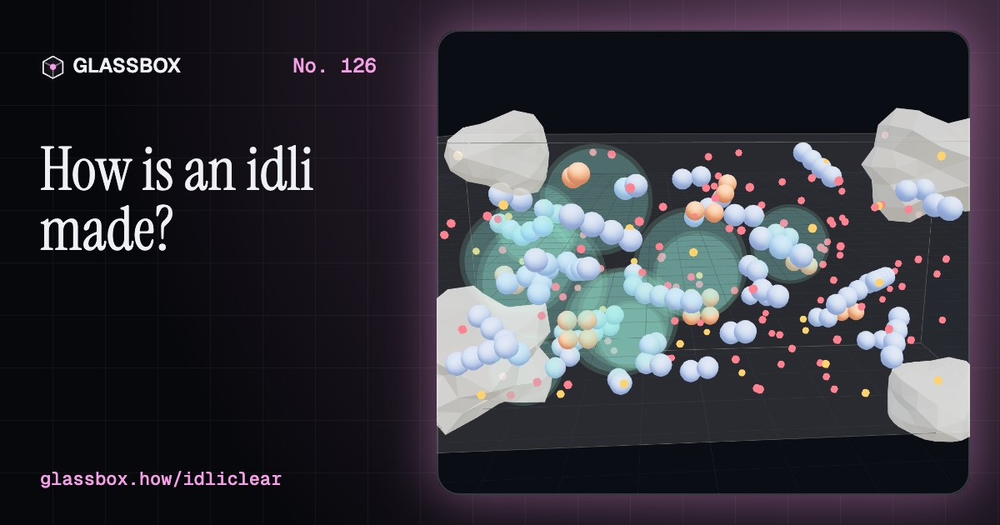
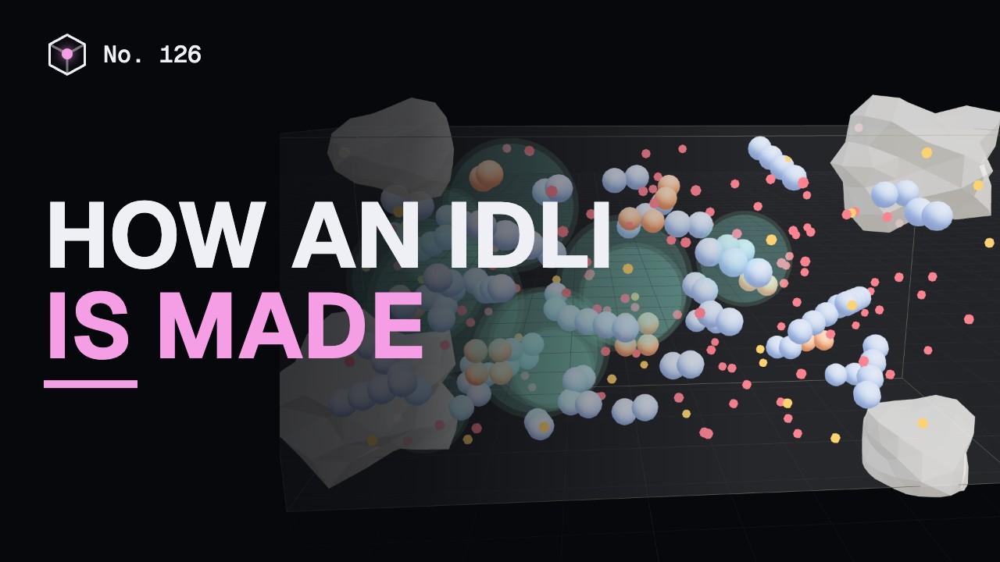
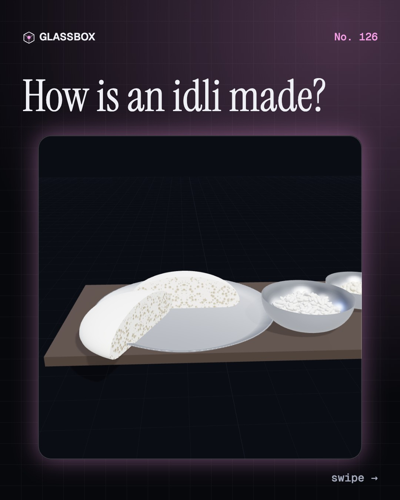
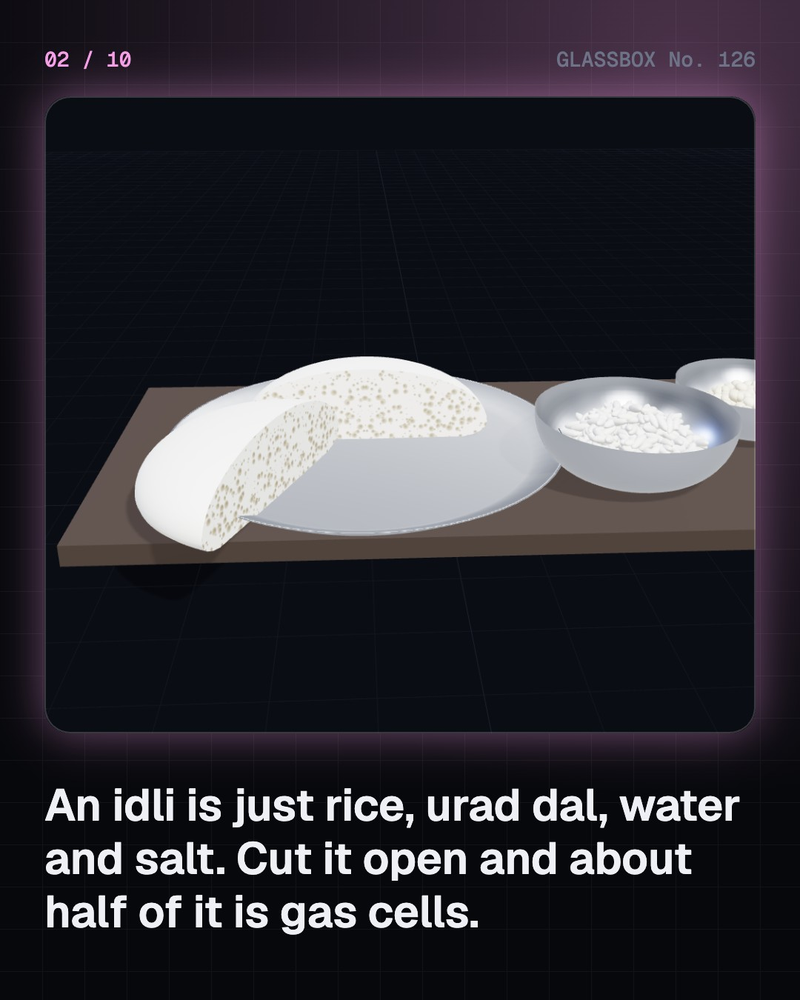
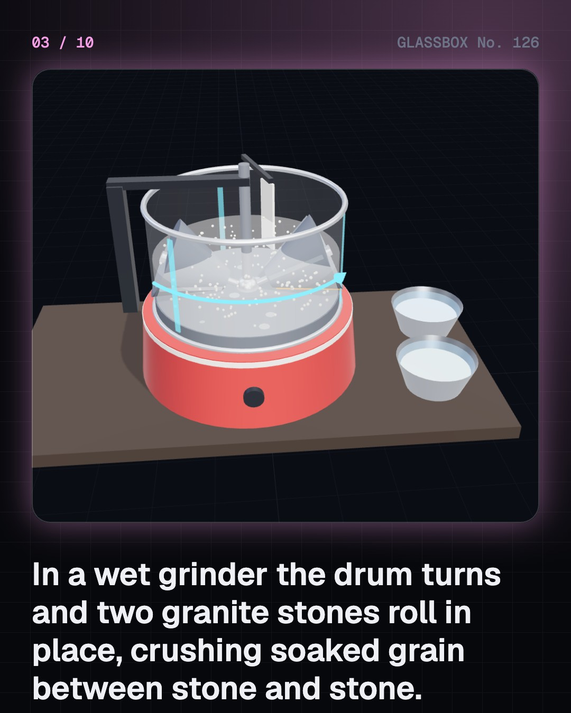
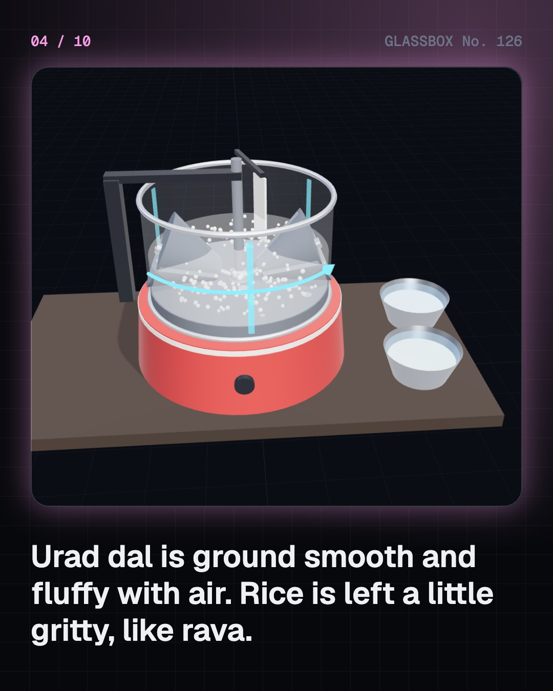

<!-- glassbox:start -->
<!-- Generated from glassbox.json by the Glassbox hub (npm run readme -- idliclear). Edit glassbox.json, not this block. -->
<p align="center"><a href="https://glassbox.how/e/idliclear/"></a></p>

<h1 align="center">IdliClear</h1>

<p align="center"><b>How is an idli made?</b><br>Rice, urad dal, water and salt go into a vessel at night, and by morning the batter has doubled, with no yeast and no starter. Meet the wild bacteria that sour it and blow the bubbles, run your own batch on a warm night and a cold one, then watch steam set the foam into a sponge.</p>

<p align="center"><a href="https://glassbox.how/idliclear/"><b>▶ Play with it</b></a> &nbsp;·&nbsp; <a href="https://glassbox.how/e/idliclear/">Read the 60-second explainer</a> &nbsp;·&nbsp; <a href="https://glassbox.how/idliclear/glassbox/reel.mp4">Watch the 40-second video</a></p>

<p align="center">
  <a href="https://glassbox.how/e/idliclear/"></a>
  <a href="https://glassbox.how/e/idliclear/"></a>
  <a href="LICENSE"></a>
  <a href="LICENSE-CONTENT.md"></a>
  <a href="#privacy"></a>
</p>

## In 60 seconds

1. **Two grains and a lot of air.** An idli is rice and urad dal, usually two to four parts of rice for one of dal, with water and salt. The rice is parboiled idli rice, which grinds to a fine grit. The dal brings protein and a slippery gum. Cut a good idli open and about half of it is gas cells.
2. **Stone on stone.** The grains are soaked for four to six hours and ground wet. In a wet grinder the drum and its granite floor turn while two roller stones spin in place. Urad is ground smooth and fluffy with air. Rice is stopped while it still feels like fine rava.
3. **Nobody adds a starter.** The bacteria arrive on the grain. The main one, Leuconostoc mesenteroides, turns each glucose into one lactic acid, one ethanol and one carbon dioxide. The acid sours the batter and the gas raises it. Urad's gum and protein coat the bubbles and keep them in.
4. **Warmth and time decide the rise.** At 25 to 35 °C the batter roughly doubles in 8 to 14 hours while its pH falls from about 6 to about 4.5. Below about 20 °C the bacteria crawl, which is why batter sits flat in a north Indian winter and cooks use the oven with its light on. Left too long, it turns sharp and sinks.
5. **Ten minutes in steam.** Steam at 100 °C condenses on the cool batter and releases 2,257 kilojoules per kilogram. The bubbles swell, rice starch gelatinises at about 65 to 78 °C and the dal proteins set, so the wet foam becomes a soft sponge. A normal idli takes 10 to 12 minutes, and a thicker one much longer.
6. **One idea, many idlis.** Pour the batter on a plate and it is thatte idli. Steam it thin on cloth and it is Ramasseri idli. Use semolina and curd and it is rava idli, raise it with toddy and it is sanna. All of them harden in the fridge as the cooked starch re-forms crystals, and soften again when re-steamed.

## Words worth knowing

| Term | Meaning |
|---|---|
| **Idli rice** | Short, bold rice that has been parboiled: soaked and steamed in the husk. It grinds to a fine grit and makes a firm, white idli. |
| **Urad dal (black gram)** | A small bean, Vigna mungo, with its black skin removed. About a quarter of it is protein, and its gum holds gas bubbles. |
| **Wild ferment** | A fermentation started by microbes already on the food. Idli batter needs no starter. |
| **Leuconostoc mesenteroides** | The lactic acid bacterium that leavens idli batter. It makes lactic acid, ethanol and carbon dioxide from sugar. |
| **Heterofermentative** | Making more than one product from sugar. Homofermentative bacteria, like most in curd, make only lactic acid and no gas. |
| **Arabinogalactan** | The gum of urad dal: a branched chain of sugars that thickens the batter and helps trap gas. |
| **Latent heat** | Heat given out when steam condenses to water without cooling: 2,257 kJ per kg at 100 °C. |
| **Gelatinisation** | Starch granules absorbing hot water and swelling into a gel. In rice it happens at about 65 to 78 °C. |
| **Retrogradation** | Cooked starch slowly re-forming crystals as it cools. It is why idli, rice and bread turn firm, fastest in the fridge. |

## A short history

**Eleven hundred years from a black gram cake in a Kannada story to a packet of live batter in the fridge.**

- **920** · The first written idli (Shivakotiacharya, Karnataka)
- **1130** · A king writes down iddarika (Someshvara III, Kalyani, Western Chalukya kingdom (today Karnataka))
- **1942** · Rava idli, born of a rice shortage (The Maiya family of MTR, Bengaluru, Karnataka)
- **1955** · The wet grinder is born (P. Sabapathy, Coimbatore, Tamil Nadu)
- **1965** · The microbe behind the rise is found (S. K. Mukherjee, M. N. Albury, C. S. Pederson, A. G. van Veen and K. H. Steinkraus, Geneva, New York)
- **1979** · Why urad holds the bubbles (N. S. Susheelamma and M. V. L. Rao, Mysuru, Karnataka)
- **1994** · Did idli come from Indonesia? (K. T. Achaya, Bengaluru, Karnataka)
- **2005** · Batter in a packet (P. C. Musthafa and his cousins, Bengaluru, Karnataka)

The full story, with 29 moments, charts, people and 38 sources: [glassbox.how/e/idliclear/history](https://glassbox.how/e/idliclear/history/). The data lives in [`history.json`](history.json).

## Video and slides

Made with the Glassbox studio from this box's storyboard (`window.glassbox.director`). Free to reuse under CC BY 4.0.

<a href="https://glassbox.how/idliclear/glassbox/video.mp4"></a>

<p><a href="glassbox/slide-1.jpg"></a> <a href="glassbox/slide-2.jpg"></a> <a href="glassbox/slide-3.jpg"></a> <a href="glassbox/slide-4.jpg"></a></p>

| File | What | Size |
|---|---|---|
| [`glassbox/reel.mp4`](https://glassbox.how/idliclear/glassbox/reel.mp4) | Reel / Short, with captions and soundtrack | 1080×1920 |
| [`glassbox/video.mp4`](https://glassbox.how/idliclear/glassbox/video.mp4) | YouTube video, with captions and soundtrack | 1920×1080 |
| `glassbox/slide-1…10.jpg` | Instagram carousel | 1080×1350 |
| `glassbox/thumb.jpg` | YouTube thumbnail | 1280×720 |
| `glassbox/cover.jpg` | Share card and repo social preview | 1200×630 |
| [`glassbox/history-reel.mp4`](https://glassbox.how/idliclear/glassbox/history-reel.mp4) | “History in 10 moments” Reel / Short | 1080×1920 |
| `glassbox/history-slide-*.jpg` | History carousel | 1080×1350 |
| `glassbox/post.json` | Post copy and schedule used by the publish kit | |

## Privacy

This box has no accounts and no ads, and it ships its own fonts and libraries. When you run it yourself it sends nothing anywhere. On glassbox.how, the site's `/bar.js` also loads Glassbox's analytics: **Google Analytics** to count visits (it asks first in the EU, UK and Switzerland, and stays off when your browser sends Global Privacy Control or Do Not Track) and **ClickTrust** to detect bots.

It remembers a few things **in your own browser only**, and never sends them anywhere:

| Browser storage key | What it holds |
|---|---|
| `idliclear.v1` | Which chapters you have opened, your best quiz scores, and sound on or off. |

Exactly what each one sees is at [glassbox.how/privacy](https://glassbox.how/privacy/).

## Licences

- **Code:** [MIT](LICENSE). Use it, change it, ship it.
- **Explanations, text, images and videos** (`glassbox.json`, `glassbox/`): [CC BY 4.0](LICENSE-CONTENT.md). Credit “Glassbox, glassbox.how/e/idliclear”.
- **Third-party parts** keep their own licences: [three.js](https://threejs.org) (MIT), [Geist, Instrument Serif](https://openfontlicense.org) (SIL OFL 1.1).
- The Glassbox name and logo aren't covered by either licence. See the [terms](https://glassbox.how/terms/).

Found a mistake? [Open an issue](https://github.com/bdeeps/idliclear/issues). Corrections happen in public.
<!-- glassbox:end -->

## Run it

It's plain HTML, CSS and JavaScript. No build step and no dependencies. Run locally, it contacts no other website.

```bash
python3 -m http.server 8000
```

Three.js and the fonts ship in `vendor/` and `fonts/`, so it also works offline.

Then open http://localhost:8000.

## How it's built

| File | What |
|---|---|
| `index.html`, `css/app.css` | The page and its styles |
| `js/app.js`, `js/stage.js`, `js/ui.js`, `js/kit.js` | The shared Glassbox 3D engine: chapters, 3D stage, controls, quiz, video director |
| `js/chapters/*.js` | One file per chapter: the 3D model, controls, text, key terms, quiz and video scenes |
| `js/model.js`, `js/idli.js` | The numbers and the shared pieces: grain composition, the fermentation and steaming models with their sources, chart boards, the idli and vessel meshes |
| `glassbox.json` | Title, question, explainer beats, key terms, browser storage and credits shown on glassbox.how |
| `reel` in each chapter | The storyboard the Glassbox studio records into short videos |
| `glassbox/` | The published video, slides, thumbnail and post copy |
| `fonts/`, `vendor/three/` | Self-hosted Geist and Instrument Serif (SIL OFL 1.1) and three.js (MIT) |
